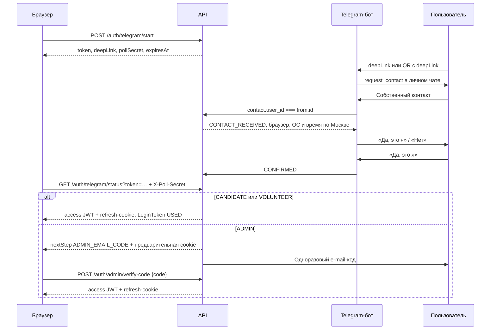

# Контракт платформы «Клуб волонтеров»

Версия **1.1.0** · документация актуализирована 30 октября 2026 года. Общий контракт backend/frontend; источник enums, подписей, переходов и общих форм — `packages/shared/src`. Исправления повторного аудита описаны в разделе 12.

## 1. Область версии 1

Платформа одного клуба: без мультиарендности, кабинетов организаций, региональных ролей и паролей. API реализован на NestJS, Prisma/PostgreSQL, Redis/BullMQ, grammY, SMTP и S3. Next.js 15 реализует публичные SSR-страницы и клиентские кабинет, раздел куратора и админку. Вход в интерфейсе использует реальный Telegram-бот.

Qamqor используется как учебный проект. Миграции добавляют явно вымышленные материалы для демонстрации, а формы и интеграции сохраняют данные на сервере. Реальный сбор пожертвований не проводится. Страницы `/policy`, `/kontakty` и `/donation` читают записи CMS с учебным содержимым; администратор может менять их через `/admin/pages`. Их начальное заполнение и поведение при отсутствии записи описаны в [PUBLIC_PAGES.md](PUBLIC_PAGES.md), состав демонстрационных данных — в [DEMO.md](DEMO.md).

Последний backend-промпт уточняет прежнюю версию контракта: LoginToken живет 5 минут, AdminLoginCode — 10 минут; опрос выполняется GET /auth/telegram/status с X-Poll-Secret; второй шаг ADMIN — POST /auth/admin/verify-code с предварительной cookie; seed сразу подтверждает ADMIN_EMAIL.

## 2. Термины и модель данных

| Модель                                       | Назначение и инварианты                                                                                                                 |
| -------------------------------------------- | --------------------------------------------------------------------------------------------------------------------------------------- |
| User                                         | UUID, telegramId bigint unique; роли CANDIDATE/VOLUNTEER/ADMIN, без паролей                                                             |
| Region                                       | UUID, name, slug; справочник фильтров и статистики                                                                                      |
| Place                                        | Учреждение; name, slug, type, regionId, city, district, address, description, privateNotes, beneficiariesCount, coverImageUrl, isActive |
| PlaceCurator                                 | Уникальная связь userId/placeId для волонтера                                                                                           |
| NeedItem                                     | Нужда учреждения; title, description, isActive                                                                                          |
| CandidateApplication                         | Одна заявка на пользователя: status, questionnaire JSON, adminComment, reviewedById                                                     |
| ApplicationHistory                           | Автор, предыдущий и новый статус, время и комментарий                                                                                   |
| OpenDaySession                               | Сессия Дня открытых дверей: startsAt, location, capacity, registrationUrl, notes                                                        |
| OpenDayRegistration                          | Уникальные sessionId/userId, attended; cancelledAt освобождает место, не стирая историю                                                 |
| Trip                                         | Поездка в учреждение: createdById, title, description, startsAt/endsAt, meetingPoint, capacity, status, cancelReason                    |
| TripRegistration                             | Уникальные tripId/userId, status, comment, createdAt                                                                                    |
| Event / EventRegistration                    | Мероприятие клуба без учреждения; type, даты, location, capacity, isPublic, volunteersOnly; уникальная запись пользователя              |
| Report / ReportPhoto                         | Один отчет на поездку, authorId, text, hoursSpent, publishedAt; фото url/isPublic=false                                                 |
| ClubReport                                   | Название, год, PDF-ссылка, дата публикации                                                                                              |
| NewsPost / Page                              | Новость с автором и статусом; страница по slug; bodyHtml санитизируется                                                                 |
| MediaAlbum / MediaItem                       | Альбом и элементы PHOTO/VIDEO, публичность и порядок; видео может быть внешней HTTP(S)-ссылкой                                          |
| Interview / Project                          | Интервью и проект со slug, HTML и обложкой; publishedAt / isActive                                                                      |
| Partner / PressMention                       | Партнеры и публикации СМИ                                                                                                               |
| Donation                                     | Ручной учет: amount Decimal, currency, donorName, note, receivedAt, createdById; онлайн-оплаты отсутствуют                              |
| ContactRequest                               | name, contact, message, status, adminNote, consentVersion                                                                               |
| Notification / NotificationSetting           | Доставка по каналам, попытки, безопасный lastError, sentAt/readAt; предпочтения пользователя по типу                                    |
| StatOverride / AuditLog                      | Ручные счетчики; автор, действие, сущность, UUID, diff, время                                                                           |
| LoginToken                                   | Хеши token/pollSecret, status, expiresAt, telegramId, attempts, IP и user-agent                                                         |
| RefreshToken                                 | Хеш, семейство ротации, хеш устройства, adminVerified, сроки/отзыв                                                                      |
| EmailToken / EmailLoginCode / AdminLoginCode | Одноразовые подтверждения адреса и входа, хеши, сроки, попытки                                                                          |
| UploadAsset                                  | Служебная запись S3: случайный key, владелец, MIME, размер, назначение, tripId, deletedAt                                               |

Учреждение — место, где клуб помогает. ORPHANAGE — детский дом; BOARDING_SCHOOL — школа-интернат; ADULT_BOARDING — интернат для взрослых; YARD_PROGRAM — дворовая программа. Для YARD_PROGRAM обязателен district, адрес необязателен. Для остальных типов обязателен address.

Telegram ID — основной внешний идентификатор. В БД bigint UNIQUE, NULL только при anonymizedAt; в JSON десятичная строка без преобразования в Number. chatId также сериализуется строкой. Телефон имеет обычный индекс, **не уникален**, не используется для объединения аккаунтов и поступает только из собственного контакта Telegram. До первого входа предсозданный администратор/пользователь может иметь phone=NULL: seed не подделывает контакт.

E-mail trim/lowercase, UNIQUE при наличии, резервный канал и вход только после emailVerifiedAt. Дата рождения — DATE; согласие хранится в User.consentAt/consentVersion. SQL CHECK закрепляет отсутствие PII у анонимизированных записей, расположение Place, неотрицательные счетчики, вместимость, порядок дат, положительную Donation, запрет Event.type=TRIP. Индексы включают Trip(status,startsAt), Place(regionId,type), TripRegistration(tripId,status), User.telegramId и User.phone.

## 3. Вход и регистрация через Telegram

Все пути ниже относительны /api/v1.

1. Start ограничен 3 запросами/IP/минуту. Token и pollSecret — независимые случайные 32 байта base64url. В БД — HMAC-SHA256 хеши с JWT_SECRET. Срок LoginToken **300 секунд**. Deep link: https://t.me/<TELEGRAM_BOT_USERNAME>?start=login_<token>. QR содержит только deepLink.
2. Бот принимает /start login_<token> только в личном чате для PENDING и неистекшего токена. Redis-связка хеш chatId → LoginToken UUID живет не дольше токена. Неизвестная ссылка получает вежливый отказ.
3. Контакт принимается только из активной связки и с contact.user_id === from.id; иначе TELEGRAM_CONTACT_MISMATCH. По telegramId создается CANDIDATE либо обновляются контакт/chatId/username, снимается botBlockedAt. Заблокированный аккаунт не входит.
4. CONTACT_RECEIVED позволяет фронту показать «Подтвердите вход в боте». Бот показывает браузер, ОС и время исходного запроса (Europe/Moscow). User-agent — подсказка человеку, а не второй фактор. Callback доступен только владельцу токена до срока. «Нет» → DECLINED; «Да» → CONFIRMED.
5. Страница опрашивает GET /auth/telegram/status?token=… с X-Poll-Secret **не чаще раза в секунду**, не более **200 запросов на токен**. Общий throttler применяется дополнительно. pollSecret не попадает в URL. Неверный секрет увеличивает attempts; после 5 ошибок токен недействителен.
6. PENDING/CONTACT_RECEIVED возвращают status/expiresAt. CONFIRMED атомарно становится USED и однократно выдает сессию или предварительную ADMIN-сессию. DECLINED/USED/неизвестный → LOGIN_TOKEN_INVALID, истекший → LOGIN_TOKEN_EXPIRED. Повторная выдача токенов запрещена.
7. Access JWT: 15 минут, только в памяти браузера, Authorization Bearer. У сессии есть серверная проверка отзыва и актуальной роли. Refresh: случайный секрет, хеш в БД, 30 дней, cookie club_refresh: **HttpOnly, Secure, SameSite=Lax, Path=/**, без Domain.
8. POST /auth/refresh ротирует refresh. Повторное использование, отзыв или несовпадение хеша user-agent отзывает все семейство. Строка User и корень семейства блокируются FOR UPDATE; фронт синхронизирует параллельные refresh. POST /auth/logout отзывает семейство и очищает cookies.
9. Браузер использует /api/v1 своего origin; Next rewrites направляет запросы в PUBLIC_API_URL. CORS разрешен только WEB_URL с credentials. Refresh/logout/admin verify требуют Origin=WEB_URL. Production — HTTPS; Secure не отключается локально.
10. При истекшем JWT фронт выполняет один refresh и повторяет запрос. JWT/refresh/pollSecret/коды не попадают в localStorage, URL или журналы. Внешний proxy также должен исключить query/header/body из access-логов авторизации.

### Второй шаг ADMIN

Подтвержденный email обязателен, иначе ADMIN_EMAIL_REQUIRED. При обмене Telegram-токена создается AdminLoginCode: 6 цифр, HMAC-хеш, **600 секунд**, максимум 5 попыток, привязка к устройству. LoginToken уже USED. До успешного кода полного access/refresh нет.

Предварительная подписанная JWT scope=admin-prelim хранится только в cookie club_admin_challenge с теми же защитными атрибутами. Ответ: status=CONFIRMED, nextStep=ADMIN_EMAIL_CODE, expiresAt. POST /auth/admin/verify-code принимает **только {code}**, cookie и Origin. Неверный/просроченный/использованный код → ADMIN_CODE_INVALID. После 5 ошибок нужен новый Telegram-вход. При смене подтвержденного адреса старые коды недействительны; сессии ADMIN отзываются.

ADMIN не может войти через резервный e-mail endpoint. Seed из ADMIN_TELEGRAM_ID/ADMIN_EMAIL сразу ставит emailVerifiedAt — доверенная операция оператора. Проверьте свой адрес до запуска seed. Онбординг и подтвержденный контакт seed не выдумывает.

### Резервный вход и привязка e-mail

POST /auth/email/login-code {email}: только существующий активный не-ADMIN с подтвержденным адресом; одинаковый {ok:true} для остальных. Ограничение 3/IP/15 минут и 3/адрес/15 минут. Код 6 цифр, 5 минут, 5 попыток, одноразовый. POST /auth/email/verify {email,code} выдает сессию; невозможно зарегистрироваться или сменить telegramId этим способом.

POST /me/email {email} отправляет ссылку на новый адрес; старый продолжает работать до подтверждения. GET /auth/verify-email?token=… потребляет 24-часовой токен и меняет email/emailVerifiedAt; дубль → EMAIL_ALREADY_USED. DELETE /me/email удаляет адрес не-ADMIN; ADMIN_EMAIL_REQUIRED запрещает оставить администратора без него. Очередь auth-mail хранит зашифрованный AES-GCM конверт; воркер проверяет активность получателя и срок перед отправкой.

### Режимы бота

TELEGRAM_MODE=polling по умолчанию: при старте getMe, проверка TELEGRAM_BOT_USERNAME, setMyCommands и deleteWebhook; затем polling. При webhook — PUBLIC_API_URL с HTTPS, TELEGRAM_WEBHOOK_SECRET и setWebhook на /api/v1/telegram/webhook. Заголовок X-Telegram-Bot-Api-Secret-Token сравнивается constant-time; повторы update_id дедуплицируются Redis.

Команды /help — «Как это работает», /status — «Мои ближайшие записи». В чатах групп приватные данные не выводятся. pnpm telegram:setup выполняет настройку вручную; pnpm telegram:info показывает наличие webhook, очередь, время и безопасную категорию последней ошибки доставки.

Без TELEGRAM_BOT_TOKEN приложение запускается, Telegram-вход возвращает TELEGRAM_UNAVAILABLE (503). DEV_FAKE_TELEGRAM=true вне production открывает POST /dev/telegram/confirm {token,telegramId,phone,fullName,contactUserId?,contactOnly?,confirm?}; по умолчанию имитируются свой контакт и «Да». Это не выдает сессию напрямую: нужен обычный status с pollSecret. NODE_ENV=production + DEV_FAKE_TELEGRAM=true останавливает запуск API и Next.

## 4. Онбординг, анкета и бизнес-правила

POST /me/onboarding принимает {birthDate:"YYYY-MM-DD",consentVersion:CONSENT_VERSION}; отправка означает согласие, consentAt ставит сервер. Возраст 18+ по календарному дню Москвы; родившиеся 29 февраля достигают возраста с 1 марта невисокосного года. UNDERAGE для младше 18. CONSENT_VERSION = 2026-10-27.v1.

До онбординга разрешены /me, /me/onboarding, /auth/* и все @Public endpoints, включая /public/*, публичные /news, /places, /open-days, контактную форму и health. OptionalJwt на публичных endpoints не открывает закрытые поля даже волонтеру, пока онбординг не закончен. Администратор также проходит онбординг.

Выбранный внутренний маршрут сохраняется в `next` через вход и обязательный онбординг. После заполнения профиля пользователь возвращается к выбранному событию, без назначения — в `/cabinet`. Клиент повторно проверяет `next` перед переходом: внешние адреса, API, вход, сам онбординг и закодированные обходы отклоняются. Это навигация, а не предоставление доступа: права по-прежнему проверяются сервером.

questionnaireSchema — единственный источник валидации анкеты и формы фронтенда; Swagger DTO описывает поля без дублирования правил.

| Поле                   | Ограничения                                |
| ---------------------- | ------------------------------------------ |
| motivation             | trim, 20–5000 символов                     |
| volunteeringExperience | trim, 1–5000; отсутствие опыта допустимо   |
| helpAreas              | Непустой уникальный мультивыбор HELP_AREAS |
| availableWeekdays      | Непустой уникальный выбор WEEKDAYS         |
| referralSource         | trim, 1–500                                |
| rulesAccepted          | Только true                                |

HELP_AREAS: CREATIVE, SPORT, EDUCATION, EVENTS, LOGISTICS, HOUSEHOLD, OTHER. WEEKDAYS: MONDAY…SUNDAY; русские подписи в shared. Strict-схемы отклоняют дополнительные поля. Общие формы также включают onboardingSchema, contactFormSchema/contactRequestSchema, emailCodeSchema, paginationSchema. Контактная форма принимает name/contact/message/personalDataConsent=true/consentVersion.

- Валидная анкета переводит NEW→QUESTIONNAIRE_DONE. ДОД можно посетить **до анкеты**: attended=true — отдельный факт, не статус. Для INTERVIEW/ACCEPTED нужны анкета и хотя бы одно посещение, иначе OPEN_DAY_REQUIRED. ACCEPTED делает VOLUNTEER; REJECTED требует комментария. История сохраняется. Отклонение ранее принятого волонтера снимает роль и закрепления.
- На поездку записывается VOLUNTEER/ADMIN только в OPEN до startsAt. Уникальная пара tripId/userId; повтор → TRIP_ALREADY_REGISTERED. Для распределения приглашений учитываются CONFIRMED и PENDING активных VOLUNTEER/ADMIN. При занятой capacity новая запись WAITLIST, иначе PENDING; прежде приглашаются уже ожидающие участники.
- Подтверждение PENDING→CONFIRMED проверяет число CONFIRMED относительно capacity в транзакции с SELECT FOR UPDATE строки Trip. При нехватке TRIP_FULL. Отмена CONFIRMED/PENDING, отклонение PENDING и увеличение capacity заполняют все свободные приглашения из WAITLIST в порядке createdAt, id. Продвижение — только в PENDING; уведомляются участник и кураторы. Уже приглашённый PENDING занимает место при распределении, поэтому новый участник не обходит очередь. Ручное продвижение использует те же правила. Прошедшие, отменённые, черновые и завершённые поездки очередь не продвигают.
- Блокировка отменяет будущие активные записи в Trip, Event и ДОД. Снятие роли VOLUNTEER/ADMIN до CANDIDATE, в том числе отзыв принятой заявки, отменяет поездки и Event только с volunteersOnly=true; открытые Event и ДОД сохраняются. Освободившиеся приглашения Trip передаются очереди в той же транзакции. Завершённое участие и прошлые записи сохраняются; разблокировка не восстанавливает отменённые записи. Повторный запрос не создаёт повторных продвижений или уведомлений.
- Явка ATTENDED/NO_SHOW только после startsAt. CLOSED→DONE доступен после отметки всех CONFIRMED; оставшиеся PENDING/WAITLIST отменяются. Отчет после DONE создает REPORTED, фото по умолчанию закрыты; редактирование отчета сохраняет статус.
- Куратор работает только со своими Place; чужие объекты → FORBIDDEN_PLACE. Trip.placeId не меняется при редактировании. Перенос даты пересчитывает напоминания; завершенные поездки не переносятся.
- Кандидат записывается на Event только при volunteersOnly=false, иначе EVENT_VOLUNTEERS_ONLY. Event.type=TRIP запрещен. Event/DOD capacity также защищен блокировкой строки.
- Все изменения статусов проходят AuditService с таблицами shared и AuditLog. Отсутствующее ребро → INVALID_TRANSITION. Начальное состояние создания задается явно.

## 5. Матрица прав

| Действие                                      | Гость | CANDIDATE | VOLUNTEER | Куратор                             | ADMIN                           |
| --------------------------------------------- | ----- | --------- | --------- | ----------------------------------- | ------------------------------- |
| Публичный контент, контакты, Telegram-вход    | Да    | Да        | Да        | Да                                  | Да                              |
| Онбординг, профиль и настройки уведомлений    | —     | Свои      | Свои      | Свои                                | Свои/управление                 |
| Анкета, запись на ДОД                         | —     | Свои      | Свои      | Свои                                | Управление                      |
| Event volunteersOnly=false                    | —     | Да        | Да        | Да                                  | Да                              |
| Event volunteersOnly=true                     | —     | Нет       | Да        | Да                                  | Да                              |
| Запись в Trip                                 | —     | Нет       | Да        | Да                                  | Да                              |
| Закрытые адрес и заметки Place                | Нет   | Нет       | Да        | Да                                  | Да                              |
| Создать/редактировать Trip                    | Нет   | Нет       | Нет       | Свои Place                          | Все                             |
| Подтвердить/отклонить участников, явка, отчет | Нет   | Нет       | Нет       | Свои Place                          | Все                             |
| Править нужды Place                           | Нет   | Нет       | Нет       | Свои Place                          | Все                             |
| Персональные данные участников                | Нет   | Свои      | Свои      | Ограниченная проекция своих поездок | По административным полномочиям |
| Пользователи, анкеты, учреждения, кураторы    | Нет   | Нет       | Нет       | Нет                                 | Да                              |
| Контент, Event, OpenDaySession, обращения     | Нет   | Нет       | Нет       | Нет                                 | Да                              |
| Ручной учет Donation, счетчики, AuditLog      | Нет   | Нет       | Нет       | Нет                                 | Да                              |

В shared: `permissionMatrix` для GUEST/UserRole и отдельное `curatorPermissions`. Куратор — **VOLUNTEER + актуальный PlaceCurator**, не роль CURATOR в UserRole/JWT. `OWN_PLACE` проверяется на сервере по placeId объекта; UUID из URL и скрытая кнопка не доказывают право доступа.

Куратор видит только **fullName, nickname, phone** участников собственных поездок в **PENDING/CONFIRMED/WAITLIST**. Сразу выбирать эту проекцию, не отдавать общий User DTO. Telegram ID, дата рождения, e-mail, анкета и согласия не раскрываются. Контакты участников REJECTED/CANCELLED/ATTENDED/NO_SHOW не входят в эту проекцию.

Region — справочник для фильтров/статистики, не разрешение доступа. Региональных ролей в v1 нет. Матрица применяется серверными guards и сервисными проверками текущей роли, онбординга и принадлежности учреждению.

## 6. Enum, подписи и переходы

Значения равны строковым именам. Подписи — labels.ts, полные таблицы — transitions.ts. Пустая правая часть означает отсутствие переходов. Повторная установка того же статуса не является ребром; идемпотентность команд задается отдельно.

PlaceType, UserRole, EventType, NotificationChannel — классификаторы без lifecycle; у них пустые таблицы. Смена роли/типа/канала — отдельная команда или настройка, а не общий status transition.

### PlaceType

| Значение        | Русская подпись       | Допустимые переходы |
| --------------- | --------------------- | ------------------- |
| ORPHANAGE       | Детский дом           | —                   |
| BOARDING_SCHOOL | Школа-интернат        | —                   |
| ADULT_BOARDING  | Интернат для взрослых | —                   |
| YARD_PROGRAM    | Дворовая программа    | —                   |

### UserRole

| Значение  | Русская подпись | Допустимые переходы |
| --------- | --------------- | ------------------- |
| CANDIDATE | Кандидат        | —                   |
| VOLUNTEER | Волонтер        | —                   |
| ADMIN     | Администратор   | —                   |

### ApplicationStatus

| Значение           | Русская подпись  | Допустимые переходы           |
| ------------------ | ---------------- | ----------------------------- |
| NEW                | Новая            | QUESTIONNAIRE_DONE, REJECTED  |
| QUESTIONNAIRE_DONE | Анкета заполнена | INTERVIEW, ACCEPTED, REJECTED |
| INTERVIEW          | Собеседование    | ACCEPTED, REJECTED            |
| ACCEPTED           | Принята          | REJECTED                      |
| REJECTED           | Отклонена        | —                             |

### TripStatus

| Значение  | Русская подпись   | Допустимые переходы   |
| --------- | ----------------- | --------------------- |
| DRAFT     | Черновик          | OPEN, CANCELLED       |
| OPEN      | Запись открыта    | CLOSED, CANCELLED     |
| CLOSED    | Запись закрыта    | DONE, CANCELLED, OPEN |
| DONE      | Проведена         | REPORTED              |
| REPORTED  | Отчет опубликован | —                     |
| CANCELLED | Отменена          | —                     |

### RegistrationStatus

| Значение  | Русская подпись       | Допустимые переходы            |
| --------- | --------------------- | ------------------------------ |
| PENDING   | Ожидает подтверждения | CONFIRMED, REJECTED, CANCELLED |
| CONFIRMED | Подтверждена          | CANCELLED, ATTENDED, NO_SHOW   |
| WAITLIST  | Лист ожидания         | PENDING, CANCELLED             |
| REJECTED  | Отклонена             | —                              |
| CANCELLED | Отменена              | —                              |
| ATTENDED  | Участвовал            | —                              |
| NO_SHOW   | Не пришел             | —                              |

### EventType

| Значение       | Русская подпись   | Допустимые переходы |
| -------------- | ----------------- | ------------------- |
| CHARITY_ACTION | Акция Клуба       | —                   |
| CLUB_EVENT     | Мероприятие Клуба | —                   |
| MASTER_CLASS   | Мастер-класс      | —                   |
| SEMINAR        | Семинар           | —                   |
| LEISURE        | Отдых и общение   | —                   |
| TRIP           | Поездка           | —                   |

### NewsStatus

| Значение  | Русская подпись | Допустимые переходы |
| --------- | --------------- | ------------------- |
| DRAFT     | Черновик        | PUBLISHED, ARCHIVED |
| PUBLISHED | Опубликована    | ARCHIVED            |
| ARCHIVED  | В архиве        | DRAFT               |

### ContactRequestStatus

| Значение    | Русская подпись | Допустимые переходы |
| ----------- | --------------- | ------------------- |
| NEW         | Новое           | IN_PROGRESS, DONE   |
| IN_PROGRESS | В работе        | DONE                |
| DONE        | Обработано      | —                   |

### NotificationChannel

| Значение | Русская подпись   | Допустимые переходы |
| -------- | ----------------- | ------------------- |
| TELEGRAM | Telegram          | —                   |
| EMAIL    | Электронная почта | —                   |
| IN_APP   | В приложении      | —                   |

### NotificationStatus

| Значение | Русская подпись | Допустимые переходы |
| -------- | --------------- | ------------------- |
| QUEUED   | В очереди       | SENT, FAILED        |
| SENT     | Отправлено      | —                   |
| FAILED   | Ошибка отправки | QUEUED              |

### LoginTokenStatus

| Значение         | Русская подпись        | Допустимые переходы                 |
| ---------------- | ---------------------- | ----------------------------------- |
| PENDING          | Ожидает контакта       | CONTACT_RECEIVED, DECLINED, EXPIRED |
| CONTACT_RECEIVED | Контакт получен        | CONFIRMED, DECLINED, EXPIRED        |
| CONFIRMED        | Подтвержден в Telegram | USED                                |
| USED             | Использован            | —                                   |
| EXPIRED          | Срок истек             | —                                   |
| DECLINED         | Отклонен               | —                                   |

### Ограничения поверх таблиц

- Trip: DRAFT→OPEN→CLOSED→DONE→REPORTED; DRAFT/OPEN/CLOSED→CANCELLED; CLOSED→OPEN. DONE/REPORTED не отменяются через общий переход.
- Registration: WAITLIST→PENDING — повторная модерация, не автоматический CONFIRMED. Отсутствующее ребро PENDING→WAITLIST не добавляется. WAITLIST становится начальным состоянием, когда CONFIRMED и допустимые PENDING заняли capacity; существующая очередь получает приглашения раньше новой записи.
- При подтверждении вместимость проверяется по CONFIRMED, иначе TRIP_FULL. При распределении приглашений дополнительно учитываются PENDING активных VOLUNTEER/ADMIN, чтобы сохранить очередь. Уникальность пары tripId/userId защищает от TRIP_ALREADY_REGISTERED. Новая запись только в OPEN, иначе TRIP_NOT_OPEN. Изменение допуска пользователя, отмена записей, продвижение, аудит и сохранение уведомлений атомарны; жертвы взаимной блокировки повторяют транзакцию целиком.
- Application: NEW→QUESTIONNAIRE_DONE после сохранения валидной анкеты; INTERVIEW/ACCEPTED — только с анкетой и посещением ДОД. Из любого другого этапа, включая ACCEPTED, в REJECTED переводит **только ADMIN** с аудитом. Изменение роли пользователя — отдельная контролируемая операция.
- LoginToken: PENDING→CONTACT_RECEIVED→CONFIRMED→USED; PENDING/CONTACT_RECEIVED→DECLINED|EXPIRED. TTL проверяется всегда, включая CONFIRMED/ADMIN challenge. Ребро CONFIRMED→EXPIRED не добавляется: истекший подтвержденный token недоступен по expiresAt и не обменивается на сессию.
- Дополнительно зафиксированы lifecycle неуточненных статусов: News DRAFT→PUBLISHED|ARCHIVED, PUBLISHED→ARCHIVED, ARCHIVED→DRAFT; ContactRequest NEW→IN_PROGRESS|DONE, IN_PROGRESS→DONE; Notification QUEUED→SENT|FAILED, FAILED→QUEUED.
- EventType.TRIP — агрегатный тип **отображения** календаря. Сохраняемый Event.type не может быть TRIP; поездки остаются Trip.

### Цвета календаря

| Тип            | Цвет    |
| -------------- | ------- |
| TRIP           | #5B4BDB |
| CHARITY_ACTION | #D48A0B |
| CLUB_EVENT     | #E47B91 |
| MASTER_CLASS   | #4596C1 |
| SEMINAR        | #9B70CC |
| LEISURE        | #E16845 |

Источник — eventCalendarColors; цвет всегда дополняется подписью.

## 7. Ошибки и соглашения API

Префикс /api/v1, JSON camelCase; id UUID, telegramId/chatId строками. Временные отметки ISO-8601 UTC; отображение Europe/Moscow. Пагинация ?page=1&limit=20 → {items,total,page,limit}: page — целое 1…21474837, limit — целое 1…100. Общая граница page гарантирует, что OFFSET=(page−1)×limit не превышает 2147483647 при любом допустимом limit. Превышение границ, дробные и нечисловые значения отклоняются до SQL с HTTP 400 и кодом VALIDATION_ERROR, в том числе в публичном и личном календаре и ленте отчётов. Decimal-суммы и hoursSpent сериализуются строками.

Входные `date-time` проверяются общей схемой клиента и API: реальная календарная дата, секунды и часовой пояс (`Z` или смещение). Несуществующий день, например 31 февраля, отклоняется до преобразования в Date; PATCH не принимает null для обязательной даты. Поле datetime-local проверяется до перевода из МСК в UTC. OpenAPI содержит ограничения административных полей: длины, шаблоны, целочисленные диапазоны, HTTP-ссылки, e-mail и размеры вложенных списков; формы используют эти метаданные.

Единая ошибка: {statusCode,code,message,details?}. Message — русский текст shared/messages.ts. Details содержит только безопасные причины/имена полей/retryAfter, без значений форм, SQL, stack trace и секретов. DTO whitelist + запрет неизвестных полей; общие формы валидируются shared Zod.

| Код                         | HTTP | Русское сообщение                                                  |
| --------------------------- | ---- | ------------------------------------------------------------------ |
| INVALID_TRANSITION          | 409  | Недопустимый переход статуса.                                      |
| TRIP_FULL                   | 409  | В поездке нет свободных мест.                                      |
| TRIP_ALREADY_REGISTERED     | 409  | Вы уже записаны на эту поездку.                                    |
| TRIP_NOT_OPEN               | 409  | Запись на поездку сейчас закрыта.                                  |
| FORBIDDEN_PLACE             | 403  | Нет доступа к управлению этим учреждением.                         |
| UNDERAGE                    | 403  | Участие доступно только с 18 лет.                                  |
| ONBOARDING_REQUIRED         | 403  | Сначала завершите онбординг и подтвердите согласие.                |
| OPEN_DAY_REQUIRED           | 409  | Заполните анкету и посетите хотя бы один День открытых дверей.     |
| TELEGRAM_CONTACT_MISMATCH   | 400  | Поделитесь своим контактом через кнопку Telegram.                  |
| LOGIN_TOKEN_EXPIRED         | 410  | Время подтверждения входа истекло. Начните вход заново.            |
| LOGIN_TOKEN_INVALID         | 400  | Ссылка или подтверждение входа недействительны.                    |
| ADMIN_EMAIL_REQUIRED        | 403  | Администратору необходим подтвержденный e-mail.                    |
| ADMIN_CODE_INVALID          | 400  | Код администратора неверен или срок его действия истек.            |
| EMAIL_ALREADY_USED          | 409  | Этот e-mail уже связан с другим аккаунтом.                         |
| BOT_BLOCKED                 | 409  | Разрешите сообщения от бота и повторите попытку.                   |
| EVENT_VOLUNTEERS_ONLY       | 403  | Это мероприятие доступно только волонтерам.                        |
| RATE_LIMITED                | 429  | Слишком много запросов. Попробуйте позднее.                        |
| VALIDATION_ERROR            | 400  | Проверьте правильность заполнения полей.                           |
| UNAUTHORIZED                | 401  | Необходимо войти в аккаунт.                                        |
| FORBIDDEN                   | 403  | Недостаточно прав для этого действия.                              |
| NOT_FOUND                   | 404  | Запрошенный ресурс не найден.                                      |
| INTERNAL_ERROR              | 500  | Внутренняя ошибка сервера. Попробуйте позднее.                     |
| TELEGRAM_UNAVAILABLE        | 503  | Вход через Telegram пока не настроен. Обратитесь к администратору. |
| ACCOUNT_BLOCKED             | 403  | Аккаунт заблокирован. Обратитесь к администратору.                 |
| CONFLICT                    | 409  | Операция конфликтует с существующими данными.                      |
| EVENT_FULL                  | 409  | На мероприятии нет свободных мест.                                 |
| EVENT_ALREADY_REGISTERED    | 409  | Вы уже записаны на это мероприятие.                                |
| OPEN_DAY_FULL               | 409  | На сессии Дня открытых дверей нет свободных мест.                  |
| OPEN_DAY_ALREADY_REGISTERED | 409  | Вы уже записаны на эту сессию Дня открытых дверей.                 |

## 8. HTTP-маршруты и OpenAPI

Все пути таблицы относительны /api/v1. Полные DTO, методы и параметры — packages/shared/openapi.json и Swagger /api/docs; /api/docs-json отдает документ. Health /health — liveness процесса, не readiness внешних сервисов.

| Доступ         | Методы и пути                                                                                                                                                                                                                                                                 |
| -------------- | ----------------------------------------------------------------------------------------------------------------------------------------------------------------------------------------------------------------------------------------------------------------------------- |
| Public         | GET /public/stats, /public/reports, /public/calendar?from=&to=, /news, /news/:slug, /pages/:slug, /albums, /albums/:slug, /interviews, /projects, /partners, /press, /needs, /open-days; POST /contact-requests (3/IP/минуту)                                                 |
| OptionalJwt    | GET /places, /places/:slug; GET /files/:id (302 на краткосрочную ссылку S3)                                                                                                                                                                                                   |
| Auth           | POST /auth/telegram/start; GET /auth/telegram/status; POST /auth/refresh, /auth/logout, /auth/admin/verify-code, /auth/email/login-code, /auth/email/verify; GET /auth/verify-email                                                                                           |
| Me             | GET/PATCH/DELETE /me; POST /me/onboarding; POST/DELETE /me/email; GET/PUT /me/application; GET /me/registrations, /me/notifications; PATCH /me/notifications/:id/read; GET/PUT /me/notification-settings; POST/DELETE /me/open-days/:id/register                              |
| Участник       | GET /trips, /trips/:id, /events, /events/:id, /calendar?from=&to=; POST/DELETE /trips/:id/register, /events/:id/register                                                                                                                                                      |
| Куратор        | POST /curator/trips; PATCH /curator/trips/:id (или /curator/trips с id в body); POST /curator/trips/:id/status; GET /curator/trips/:id/registrations; PATCH /curator/registrations/:id; PUT /curator/trips/:id/report; PATCH /curator/places/:id/needs; POST /uploads/presign |
| ADMIN          | CRUD /admin/users, /admin/regions, /admin/places, /admin/events, /admin/open-days; назначения /admin/curators; GET /admin/applications и /:id, POST /:id/status; списки/явка Event и ДОД                                                                                      |
| ADMIN контент  | CRUD /admin/news, /admin/pages, /admin/albums, /admin/media-items, /admin/interviews, /admin/projects, /admin/partners, /admin/press, /admin/club-reports, /admin/donations                                                                                                   |
| ADMIN контроль | GET/PATCH /admin/contact-requests; GET/PUT /admin/stat-overrides; GET /admin/audit-log, /admin/notifications?status=FAILED                                                                                                                                                    |

Trips фильтруются regionId/placeType/dateFrom/dateTo/status (по умолчанию OPEN). Диапазон календаря не больше 366 дней. Публичная поездка в календаре — только UUID, type=TRIP, заголовок «Поездка», даты и регион, без учреждения и места сбора. /calendar для участника содержит доступную его роли проекцию; DRAFT виден только куратору своего учреждения и ADMIN.

GET /me/registrations без upcoming или с upcoming=false возвращает полную историю по createdAt DESC. Кабинет запрашивает upcoming=true&limit=6: сервер до пагинации объединяет будущие поездки, мероприятия и ДОД и сортирует по startsAt ASC, затем id и виду записи. У поездок и мероприятий учитываются только PENDING, CONFIRMED и WAITLIST; поездка должна быть OPEN или CLOSED. У ДОД исключаются отменённые и уже посещённые записи. Начало должно быть строго позже текущего серверного времени; total и search используют те же условия. Флаг upcoming принимает только true/false. Отмена остаётся в истории, но исчезает из ближайших записей.

Гостю Place отдает id/slug/name/type/region/city/description/coverImage/beneficiariesCount и district у YARD_PROGRAM. Address/privateNotes/meetingPoint и непубличные ReportPhoto доступны только волонтерам/ADMIN после онбординга. /public/reports содержит опубликованные отчеты клуба и поездок, только isPublic=true фото. Предподписанная ссылка живет 5 минут; после изменения прав ранее выданная ссылка действует до истечения.

pnpm gen:api собирает shared/api, экспортирует документ **без HTTP-порта, подключения к БД/Redis, воркеров и запуска бота**, затем генерирует apps/web/src/lib/api/schema.d.ts через openapi-typescript. client.ts использует openapi-fetch, тот же origin и credentials:include; access подставляется из памяти, параллельные 401 используют один refresh и однократный повтор. Экспорт и типы коммитятся вместе с кодом.

## 9. Уведомления, файлы и статистика

NotificationService создает DB-outbox внутри бизнес-транзакции. IN_APP создается всегда для активного получателя (SENT), Telegram и e-mail — по NotificationSetting. По умолчанию Telegram включен при chatId; e-mail включен только при подтвержденном адресе. Нет отдельной привязки бота.

Dispatcher восстанавливает BullMQ jobs из QUEUED. До 5 попыток, exponential backoff, Telegram 429 учитывает retry_after, лимит Telegram 25 сообщений/секунду. SENT/FAILED и attempts/lastError хранятся в БД; lastError содержит только безопасные коды. При 403 фиксируются BOT_BLOCKED и User.botBlockedAt; создается e-mail fallback при подтвержденном адресе **даже при отключенном обычном email-предпочтении**, как специальное исключение для отказа Telegram. /me содержит botBlockedAt для предупреждения.

Типы shared/NOTIFICATION_TYPES: ApplicationStatusChanged, RegistrationConfirmed, RegistrationRejected, RegistrationWaitlisted, RegistrationPromotedFromWaitlist, RegistrationCancelled, TripCancelled, TripRescheduled, TripReminder24h, TripReminder3h, NewRegistrationForCurator, ReportRequestedFromCurator, OpenDayReminder, EventRegistered, EventCancelled, OpenDayRegistered, EventRescheduled, OpenDayRescheduled.

Изменение startsAt/endsAt/location мероприятия создает EventRescheduled для PENDING/CONFIRMED/WAITLIST активных допустимых участников; изменение startsAt/location ДОД создает OpenDayRescheduled для неотменённых и ещё не посещённых записей. Новые сообщения содержат полное актуальное время и место и доступны в кабинете; Telegram/e-mail следуют отдельным настройкам этих типов. Создание события, правки остальных полей и повторное сохранение одинаковых данных сообщений о переносе не создают. Даты сравниваются как моменты времени. Снимок под блокировкой события, правка, аудит и outbox сохраняются атомарно; жертва взаимной блокировки повторяет транзакцию. При повторном переносе или прекращении участия отложенные внешние сообщения с устаревшим расписанием помечаются FAILED/SCHEDULE_OBSOLETE без отправки; отправленные сообщения остаются в истории.

Русские шаблоны едины в notifications/templates.ts, ссылки используют WEB_URL. Delayed jobs: поездка за 24 и 3 часа, отчет кураторам через сутки после endsAt, ДОД за 24 часа. Reconcile каждые 30 секунд; перенос/отмена делает старую задачу недействительной по версии времени. Notification.dedupeKey исключает повторное создание. Worker перед отправкой проверяет статус и активность получателя; физическая доставка внешнему сервису имеет семантику at-least-once.

POST /uploads/presign выдает **presigned S3 POST**: url, fields, uploadId, fileUrl, expiresAt, maxSizeBytes. Фронт отправляет multipart FormData со всеми fields и file последним. Signed policy фиксирует MIME и точный объявленный размер; срок 5 минут. JPEG/PNG/WebP до 10 MiB; PDF до 20 MiB только CLUB_REPORT и ADMIN. REPORT_PHOTO привязан к собственной поездке куратора; CONTENT/CLUB_REPORT только ADMIN. Перед включением в отчет/CMS сервер проверяет HEAD и сигнатуру первых байт. SVG/HTML и другие типы отклоняются. В БД сохраняется внутренний key или стабильный fileUrl, а не истекающая GET-ссылка. Бакет приватный.

Для MediaItem сервер проверяет итоговую пару type/url внутри транзакции, объединяя PATCH с текущей записью. Управляемые файлы определяются по стабильному fileUrl или S3-ключу и проверяются по MIME: JPEG/PNG/WebP совместимы с PHOTO и недопустимы для VIDEO. Внешние HTTP(S)-ссылки на видео сохраняются. Смена PHOTO↔VIDEO требует новой ссылки; прежний URL и PATCH только с изменением типа отклоняются с 400 VALIDATION_ERROR. Форма очищает URL при смене типа и требует ввести его заново; загрузка изображения при переключении отменяется и не может вернуть старую ссылку поздним ответом.

GET /files/:id для CONTENT/CLUB_REPORT доступен гостю и участникам только при наличии хотя бы одной текущей публичной ссылки на файл: опубликованная новость, альбом или интервью (publishedAt <= текущего времени; для элемента альбома также isPublic=true), активное учреждение, проект или партнер, опубликованный отчет клуба или публикация СМИ. HTML страниц доступен публично всегда; ссылки img.src и a.href учитываются также в опубликованных новостях/интервью и активных проектах. Учитываются точные fileUrl на WEB_URL/PUBLIC_API_URL и относительные ссылки, но не UUID в обычном тексте или URL другого сайта. Скрытие, удаление или замена последней публичной ссылки сразу запрещает выдачу новых S3-ссылок. Файл, используемый несколькими материалами, остается публичным, пока доступен хотя бы один из них. Ранее выданная S3-ссылка живет до 5 минут.

Незакрепленные и непубличные CMS-файлы доступны только ADMIN после онбординга и второго шага входа. GET /uploads/:id/preview требует Bearer ADMIN и возвращает {url} с краткосрочной S3-ссылкой для предпросмотра в редакторе. Редактор сохраняет в HTML исходный стабильный fileUrl; подписанная ссылка используется только для отображения изображения и не сохраняется в материале. Обычный img/a-запрос без Bearer не получает привилегии из refresh-cookie.

GET /public/stats возвращает семь чисел:

| Ключ                       | Расчет                                                           |
| -------------------------- | ---------------------------------------------------------------- |
| places                     | Активные учреждения                                              |
| curators                   | Уникальные активные VOLUNTEER с PlaceCurator активных учреждений |
| events12Months             | Мероприятия за последние 12 месяцев                              |
| masterClasses12Months      | MASTER_CLASS за тот же период                                    |
| uniqueParticipants12Months | DISTINCT userId с ATTENDED в поездках/мероприятиях за период     |
| beneficiaries              | Сумма beneficiariesCount активных учреждений                     |
| trips                      | Завершенные DONE/REPORTED за все время                           |

Расчет из БД кешируется в Redis на 600 секунд, сверху читается актуальный StatOverride. PUT /admin/stat-overrides {items:[{key,value}]}: целое >=0, 0 допустим, null удаляет переопределение. Обращения, Donation и аудит доступны только ADMIN; онлайн-платежных endpoints нет.

## 10. Окружение, запуск и данные

Единые имена: NODE_ENV, DATABASE_URL, REDIS_URL, JWT_SECRET, WEB_URL, PUBLIC_API_URL, S3_ENDPOINT, S3_BUCKET, S3_ACCESS_KEY, S3_SECRET_KEY, SMTP_HOST, SMTP_PORT, SMTP_USER, SMTP_PASS, MAIL_FROM, TELEGRAM_BOT_TOKEN, TELEGRAM_BOT_USERNAME, TELEGRAM_WEBHOOK_SECRET, TELEGRAM_MODE, DEV_FAKE_TELEGRAM, ADMIN_TELEGRAM_ID, ADMIN_EMAIL. .env.example объясняет происхождение каждого значения; .env игнорируется Git и Docker.

PUBLIC_API_URL — серверный upstream Next и внешний base URL webhook (без /api/v1); browser fetch использует свой origin. При проксировании webhook внешний HTTPS URL должен вести к Nest. TELEGRAM_BOT_USERNAME без @. В production нужны доступные PostgreSQL/Redis/S3/SMTP в выбранной инфраструктуре и HTTPS WEB_URL.

pnpm install генерирует отсутствующий локальный .env с независимыми JWT/S3 секретами; не перезаписывает файл, не генерирует production/CI окружение. pnpm db:deploy применяет миграции без сброса данных. pnpm db:seed — идемпотентный seed: 10 основных регионов РФ, администратор из ADMIN__; локально 8 демонстрационных Place (в том числе 2 YARD_PROGRAM), нужды, 2 ДОД и при настроенном администраторе по 3 новости/Event/Trip. При пустых ADMIN__ авторские демозаписи пропускаются с пояснением. В production db:seed не добавляет демоданные. Отдельная миграция 20261030030000_educational_demo во всех окружениях один раз создаёт учебный набор: 4 Place, 12 нужд, 3 Event, Trip, 2 ДОД и 2 новости. Их автор — заблокированная запись CANDIDATE без идентификаторов входа, контактов и согласия. Миграция не выдаёт права реальным пользователям. Повторное применение сохраняет правки, даты и регистрации; состав и сценарий описаны в docs/DEMO.md.

Helmet, CORS, Redis throttler, глобальные guards и safe pino-логи включены. Приложение доверяет только loopback proxy; внешний reverse proxy должен перезаписывать X-Forwarded-For и исключать чувствительные поля из логов. Graceful shutdown прекращает timers/polling, дожидается активных BullMQ workers и закрывает БД, Redis, SMTP, S3.

Локальный `apps/api/Dockerfile` запускает API от непривилегированного пользователя и содержит liveness healthcheck; миграции для него применяются отдельным шагом перед запуском. Vercel использует корневой `Dockerfile.api`: HTTP entrypoint `start-vercel.js` при `VERCEL_ENV=production|preview` выполняет `prisma migrate deploy` и только затем запускает API без фоновых workers. Отдельный daemon запускает `worker.js` и сам миграции не применяет. Runtime включает Prisma Client, CLI и миграции; корневой Dockerfile также упаковывает нативный schema engine. Детали — в [VERCEL.md](VERCEL.md).

## 11. Анонимизация и изменение контракта

DELETE /me и административное удаление сохраняют UUID, регистрации, явку и структуру отчетов для статистики. Обнуляются telegramId/chatId/phone/email/emailVerifiedAt/birthDate/telegramUsername, nickname/avatar/city/consent/lastLogin, fullName становится «Удаленный пользователь», роль CANDIDATE, isBlocked=true. Все refresh отзываются; login/email/admin challenges и настройки/уведомления удаляются. Свободные тексты анкеты, комментариев и авторских отчетов очищаются; фото удаляются из отчетов, UploadAsset маркируются deletedAt для S3 cleanup. API сразу запрещает доступ к помеченным объектам. Повторный Telegram-вход создает новый аккаунт без объединения по телефону.

Текущая учебная конфигурация использует выбранные владельцем зарубежные регионы Vercel, Neon, Upstash и Tigris; параметры размещения описаны в [VERCEL.md](VERCEL.md). Учебное содержимое страницы `/policy` описывает работу приложения. Адаптация для реальной организации, включая сведения об операторе и правила обработки и размещения данных, требует отдельного согласования; её границы описаны в [PUBLIC_PAGES.md](PUBLIC_PAGES.md).

Изменения enums/labels/transitions/форм/ошибок/прав согласуются в shared, документации и OpenAPI с повторной генерацией frontend-типов. Тесты проверяют общий контракт, HTTP-авторизацию, права/приватность, конкурентное подтверждение последнего места, путь кандидата до отчета, контент, уведомления и локальную инфраструктуру.

## 12. Уточнения по результатам повторного аудита

Бизнес-транзакции записи на Trip/Event/ДОД и сохранения анкеты повторно проверяют актуальное состояние пользователя. Блокировка User берется перед предметной записью; она совместима с внешними ключами уведомлений и исключает повторное сохранение персональных данных после успешной анонимизации. Права куратора проверяются по актуальной роли и PlaceCurator.

GET/PUT `/me/notification-settings` также проверяют активного пользователя под блокировкой User. Проверка, upsert и ответ со снимком настроек выполняются в одной транзакции. Запрос, ожидающий завершения анонимизации, получает ACCOUNT_BLOCKED; сохранение, начавшееся раньше, завершается перед удалением своих строк.

Статусное изменение заявки ADMIN возвращает полную проекцию AdminApplicationResponseDto, включая history. Nullable-примитивы, page/limit и isPublic описаны в OpenAPI соответствующими string/number/boolean; схемы Object вместо примитивов недопустимы.

Logout инвалидирует также предварительный ADMIN challenge. Повтор собственного Telegram-контакта в CONTACT_RECEIVED до истечения позволяет заново отправить кнопки устройства без второго перехода статуса. Чужой контакт и повтор после использования/отказа не принимаются. Отсутствующий актуальный telegramUsername очищает ранее сохраненный username при новом входе.

Перед доставкой напоминания из outbox сервер повторно проверяет дату/состояние поездки или ДОД, подтвержденное участие, отмену записи, наличие опубликованного отчета и актуальное назначение куратора. Устаревшее уведомление получает FAILED с безопасным lastError=REMINDER_OBSOLETE без внешней отправки. Для просьбы об отчете payload содержит scheduledAt, чтобы перенос endsAt также инвалидировал старую доставку. Уже завершенную внешнюю доставку отозвать невозможно; сохраняется семантика at-least-once.

Некорректное или слишком большое JSON-тело возвращает VALIDATION_ERROR без исходных данных. Donation.amount находится в диапазоне 0 < amount <= 999999999999.99 с точностью до двух десятичных знаков. Занятый email возвращает EMAIL_ALREADY_USED и при конкурентном подтверждении. Ошибка запуска закрывает созданное приложение/очереди перед завершением процесса.

## 13. Интеграция web

Локально Next работает на 3000, Nest — на 4000. Новая верстка использует #5B4BDB/#FFB020, локальные SVG и общий набор компонентов. Публичные маршруты рендерятся на сервере; запросы используют revalidate=60 и пересылают cookie входящего запроса. Персональные запросы выполняются в браузере с access JWT, без сохранения access/refresh/pollSecret в localStorage. PollSecret остается в памяти компонента входа. Refresh cookie имеет Path=/; middleware проверяет только ее наличие. Роль, онбординг и права проверяются клиентским layout по GET /me и shared, окончательное решение принимает backend.

Дополнения контракта без смены существующих значений:

- `ApplicationResponseDto.hasOpenDayAttended` и наследуемая административная проекция — факт хотя бы одного `OpenDayRegistration.attended=true`, независимо от статуса и наличия анкеты. В административной проекции не раскрывается внутренняя выборка регистраций.
- Отказ в Telegram возвращает `LOGIN_TOKEN_INVALID` с `details.status=DECLINED` только после проверки правильного `X-Poll-Secret`. UI останавливает опрос и предлагает повторить вход. Текущий код ненастроенного бота — `TELEGRAM_UNAVAILABLE`; web также понимает `TELEGRAM_NOT_CONFIGURED` как совместимый ответ.
- `GET /public/regions` — публичный справочник. `GET /interviews/:slug` и `GET /videos` возвращают опубликованные материалы; видео обязательно публично и относится к опубликованному альбому.
- `GET /curator/trips` с теми же фильтрами и пагинацией возвращает поездки закрепленных учреждений; ADMIN видит все. `GET /curator/places` и `GET /curator/places/:id/needs` позволяют редактировать свой список нужд, включая неактивные записи. Проверки PlaceCurator остаются серверными.
- `POST /uploads/presign` принимает также `purpose=AVATAR` для прошедшего онбординг участника. Аватар принадлежит загрузившему пользователю, проверяется MIME/размер/сигнатура; в `/me` сохраняется стабильный `/api/v1/files/:id`, а возвращается краткосрочная подписанная ссылка. Чужой аватар недоступен; AVATAR не подходит для публичных CMS-обложек.
- Закрытая карточка отчета возвращает `photos[].uploadId`, чтобы последующее сохранение сохранило исходные фотографии. Публичный feed отчетов не возвращает этот идентификатор.
- Подтверждающее e-mail письмо ведет на web `/verify-email?token=...`; эта страница вызывает `GET /auth/verify-email` без кеширования.

Административные формы и типы генерируются `pnpm gen:client` из экспортированного OpenAPI. Telegram-сценарий с настоящим ботом проходит вручную по `docs/LOCAL_CHECKLIST.md`; подмена ответов авторизации существует только в тестах.
